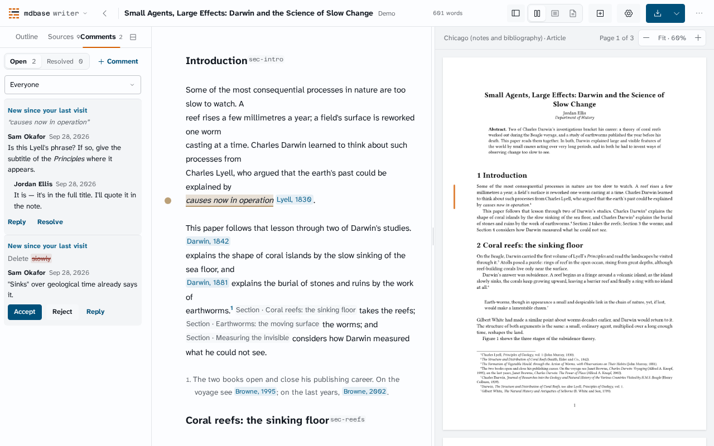
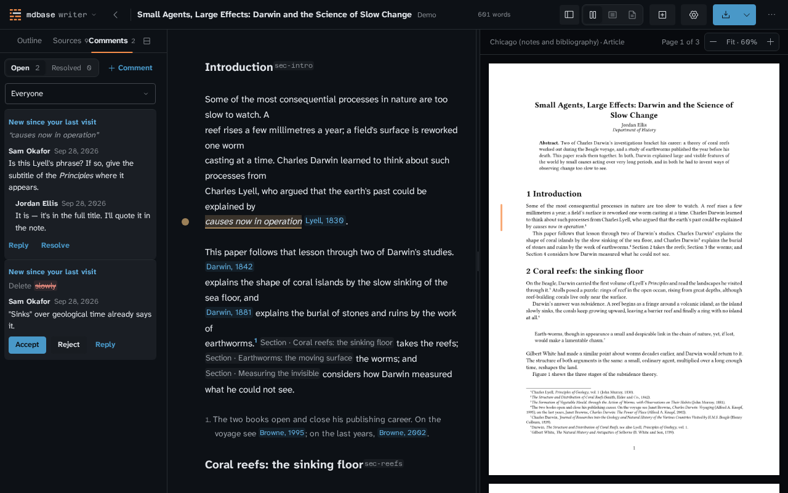

# Writer round 7

Branch: `polish-r7`, based on `c2f19fdfffd80d0e4d70faade1ea687ea4c4157e`.
Scope is the round-seven Writer plan. PR #20 and lower-panel behavior are not
changed. No deployment or merge is part of this change.

## Delivery ledger

| Plan item | Result | Before → after; proof boundary |
| --- | --- | --- |
| W1.1 SDK intake | Implemented; live recovery unproven | LAB/staging `eaa4e697`, production beta.156 → all three beta.157. Original archives verified, not repacked. Quota recovery has not been exercised with the candidate on LAB. |
| W1.2 Reload/write | Repeatable check added; not run against candidate | Council LAB write loss 2/2 → no new live survival rate claimed. `test:lab:reload-write` requires an owned `[test]` manuscript, reloads before writing, waits for the real session acknowledgement, and reads from a new context with no Writer origin storage. It restores the original body in cleanup. |
| W1.3 Sync truth | Implemented and unit-tested | A local-only save could remain a waiting notice indefinitely → rejected ledger entries immediately, or pending age ≥30,000 ms, say “Changes haven't reached the server”. The existing save slot offers Download local drafts and a polite live region. A timer advances the notice without requiring another SDK snapshot; confirmation clears it. No SDK write, retry or acknowledgement is altered. “Stay online” was absent from Writer's source before this change. |
| W1.4 Revoked access after reload | Not fixed or live-proven | No before/after revoked-access result is claimed. This remains a shared SDK/problem-descriptor follow-up, not a Writer auth workaround. |
| W1.5 Cancel / collection hint / Install | Install fixed; Cancel blocked on missing SDK discriminator | Current deployed LAB Cancel reproduced “Can't continue / Sign-in didn't go through”; Install was also present on that gate. The app now permits installation only under Home/workspace, with removal on gate transitions (unit test). Beta.157 collapses consent denial into general `refused` and loses the server problem at its worker boundary; Writer cannot safely identify cancellation (code trace below). No claim that cancellation or preselection is fixed. The reload check records preselection and only approves the explicitly named test collection. |
| W2.1 Sidebar work | Implemented; final browser budgets pass | Original dev sample: 63–93 ms long tasks and 45–90 ms setup-to-fade; council 55–107 ms. After the follow-up fixes, all eight R4 viewport cases pass both traced and untraced, plus all three platform cases. The four traced 10k-word desktop maxima are 29.451 / 38.166 / 29.874 / 22.514 ms, with zero ≥50 ms tasks. Final optimized actual-key-to-fade is 5.3–8.2 ms over four toggles; first bitmap mutation is 198.2–211.9 ms, after the unchanged 160 ms animation. These are machine/build-specific measurements, not a controlled percentage improvement. |
| W2.2 Hidden prose | Implemented and browser-tested | Switching to preview-only previously started WAAPI and CSS fades on the hidden editor → zero animations on hidden Write and Preview containers in the optimized gate. Deleted the desktop/mobile prose hide fade rather than adding another animation. A new artifact while Preview is hidden produces zero canvas mutations. Verified that plain `checkVisibility()` returned true on CSS-hidden Preview; the guard now checks the visibility property explicitly. Preview remains undimmed. |
| W2.3 Semantic DOM | Implemented and browser-tested | Size-only rendering previously rebuilt each page's semantic children → all five already-rendered page nodes retain identity over four toggles at document revision 1. A sixth previously-undrawn page enters the lazy render range and receives its first semantic node; that is not a replacement. Document-version changes own replacement; size-only draws update geometry. |
| W2.4 Home warm-up | Implemented; controlled baseline missing | Original dev immediate-open first ink 3,116 ms; optimized samples 1,088–2,200 ms, and the final follow-up optimized sample 1,731 ms. No production baseline at the original source was rebuilt, so these are observations, not a like-for-like speedup claim. The existing compiler preparation request and renderer promise are reused; an unconsumed compiler is terminated when Home unmounts. |
| W2.5 Motion gate | Implemented; final gates pass | The unchanged <50 ms budget caught 52 / 57 ms tasks initially and 51 / 114 / 80 ms in an intermediate untraced run. Fixed the Writer-owned style invalidation, forced geometry read, and combined render/install task; see task attribution below. The final traced matrix has zero long tasks, and the full untraced R4 gate also passes. The third-party render callback still costs 14.580–25.178 ms per page at its observed maxima; it is no longer combined with bitmap installation in one task. Original trajectory, no-hidden-draw, real-rendered-revision and semantic-identity assertions remain. |
| W3.1 Palette | Implemented | Six existing actions newly exposed: Add chapter, New manuscript, three sidebar tabs and Retry preview. View modes, F8, themes and All manuscripts already existed; they are not credited as additions. Default visible options stay 35 → 35 because the shared palette caps each browse group. Search reaches the additional actions. New manuscript reuses Home's dialog and the existing save-before-leave decision, preserving its destination on retry/explicit leave. |
| W3.2 Keyboard | Implemented, including tooltip convergence | Ctrl+K and Ctrl+/ now toggle their own overlays; Home ? opens help outside text fields, without intercepting composition. Two Ctrl+F rows → one “Find and replace” row. Palette, sheet, selection toolbar, comment composer/reply, sidebar, export and outline reorder hints now use the existing shared `shortcutLabel` helper. All three platform checks assert the actual source/export tooltips. Explicit Control+Space stays Control on Apple (`⌃Space`), not Command. Pointer gestures such as Ctrl-click and prose instructions are not keyboard-chord tooltips. No formatter/dependency was added. |
| W4.1 Alignment/chips/colour | Implemented; unread-thread sample captured in both themes | Continue ink x402.39, goal ink x407.99, row ink x393 → x393, x393.01, x393. Reference chip width 127.25 →125.16 px (same text/font), inline padding .20em →.12em. Dark primary OKLCH lightness .73 →.65 using the existing stronger token, not a new colour. Approximate text contrast from the measured colors, converted through Chromium's sRGB canvas: light 6.32 →8.18, dark 8.10 →6.00. The unread thread's inset 2 px stripe is replaced by the existing selected fill. Two real demo unread threads are captured per theme: light `oklch(0.968 0.004 255)`, dark `oklch(0.235 0.012 255)`, both `box-shadow: none` / left border `0px`. See the fixture and screenshots below; this is local demo proof, not a live-account or independent contrast claim. |
| W4.2 Home balance | Intentionally unchanged | Existing history remembers one most-recent chapter per manuscript, already represented by Continue. No recent-chapters list or invented history state is added. |
| W4.3 Touch targets | Implemented and measured | Cite 40×44 →44×44 px on the 390 px touch viewport. Council's Replace summary 20×44 →55×44 px on the current touch viewport, with an explicit 44 px minimum on every viewport. The old 20 px width is council evidence, not a fresh baseline reproduction. |

## SDK evidence

Release: `sdk-v0.1.0-beta.157`, source
`493d29ca2a3494c5d59677e8b83e309b44a28c31`.

| Original | SHA-256 |
| --- | --- |
| LAB release asset | `927cc688a22d0931207d9108b53958e3279f2d2d711342b04ac80c02d8091e26` |
| Staging release asset | `3efb7888ef59b6449ecff7c717b123dfaf94b3ae6257bcae4f1e7113a82a0d4c` |
| Production npm archive | `c44bce54c56239a6489e3f909638a8b900e48e41d286d77e9d9732c7172d199c` |

LAB/staging asset and bundle digests were checked against GitHub release
metadata; `gh attestation verify` verified the repository, workflow and source.
Production uses the exact npm dependency `@mdbase-dev/sdk@0.1.0-beta.157`, with
npm integrity/provenance verification and a committed original for publisher
byte comparisons. Runtime SHA-256 is
`d375ce16a48dec718801704f56ffb6a545247a2793912c2c8e68ceb171ff2537` in all three.

The publisher now authenticates the npm importer/resolution instead of assuming
production is a file dependency. Its staging derivation changes only the SDK
source/integrity and corresponding peer identity, retaining the exact freeze of
other dependencies and comparison of every installed original member.

Idle compiler ownership also covers preparation failure: an already-terminated
worker must not stay in the warm cache and later become a workspace's compiler.
The narrow file was 7 passing / 1 failing before the fix; all 8 tests pass in
the final full-suite run. The
existing worker failure subscription now clears the cache, and Home cleanup
removes that subscription; normal workspace initialization remains the only
initialization path when no prepared worker is available. No retry loop or
separate error state is added.

## Consent cancellation: exact SDK boundary

The visible gate is Writer’s screen, implemented through its existing shared
`CollectionGate`; it is not dismissed as somebody else’s UI. However, the
installed, signed beta.157 SDK does not preserve the distinction Writer needs:

- `dist/app-host/installation-sign-in.js:450`–454 converts a 404
  `installation_pairing_denied` to `fail("refused")`, dropping the server
  problem. `consentWindow` repeats that conversion at lines 697–702.
- The same bare `refused` is used for actual authorization failures (including
  lines 988 and 1014), so suppressing every refusal would hide real failures.
- `dist/application/worker-protocol.js:73`–74 serializes this class to only
  `{code: error.reason}`. The public error/snapshot has no separate consent-
  declined outcome or retained denial problem across that boundary.
- The descriptor already treats bare `refused` as informational “Sign-in wasn't
  finished”; a refusal with server details uses failure copy. That does not
  prove what the undeployed candidate displays after a real consent cancellation.

Needed upstream: a public, serialized user-declined/cancelled outcome (or the
retained `installation_pairing_denied` problem), distinct from general refusal,
preserved into the snapshot/descriptor used by `CollectionGate`. No Writer
string matching, signed-asset patch, or blanket suppression is added.

## Unread-thread visual fixture

The supported demo route uses `?demo&manuscript=manuscripts%2Fslow-change.md`.
Before loading it in a fresh context, seed the existing
`mdbase-writer:recent:demo` key with
`[{"path":"manuscripts/slow-change.md","at":"2026-09-27T00:00:00Z"}]`.
Open Comments. The two September 28 demo threads receive `.thread.is-new`
through the real recent-visit comparison, not by forcing classes. The R7 gate
asserts both threads’ fill token, lack of inset shadow, and zero left border
in each theme.





## Follow-up failure diagnoses

- **R2 — test harness lifetime defect, not navigation.** The follow-up reproduced
  the failure after 0 and 2 completed cases. Raw CDP reported error -32000,
  `Promise was collected`; Playwright rewrote that to the misleading generic
  “Execution context was destroyed” error. Navigation/Vite event diagnostics
  showed no navigation at the failed hold resolution. The test now roots the
  one pending fixture operation on `window`, waits for its result with a finite
  60-second bound (the old evaluate had no bound), asserts exactly
  `{outcome: "confirmed"}`, and removes the root. It does not retry, invent a
  receipt, or substitute the UI’s Saved label. Final result: **8/8**.
- **R4 phone — stale test expectation.** The old gate required a new bitmap
  while Preview was intentionally hidden. It now explicitly opens Preview,
  waits for the actual rendered revision, and returns to Write before its
  existing scroll/position assertions. No false rendered marker is written.
- **R4 desktop — product performance defects.** The long-task failures were
  real. The inherited grid variables invalidated the entire semantic subtree;
  the canvas height read forced layout after writes; renderer and bitmap work
  could consume one task. These are fixed in Writer, not exempted in the gate.
- **R4 platform — intentional notation update.** The stale `Ctrl-Space`
  assertion becomes `Ctrl+Space` (`⌃Space` on Apple), with actual Sources and
  Export tooltip assertions added on macOS, Windows and Linux.
- **R6 — intentional upstream copy change, stale assertion.** Beta.157 replaces
  “Delete a synced collection before creating another” with “Open an existing
  collection, delete one you own if Delete is available, or contact mdbase
  support to raise your limit”. The assertion now checks that exact actionable
  guidance. Its no-retry/no-add, visibility, link and recovery assertions remain.
- The new unread fixture initially compared raw custom-property syntax with a
  computed color. Optimized CSS represents the same color with different LAB
  syntax. Both operands now go through computed `backgroundColor`; the exact
  selected-fill equality, no-shadow and zero-border requirements are unchanged.

## Sidebar task attribution (W2.5)

The budget still rejects **every ≥50 ms main-thread task** in the same observed
sidebar interval. It has no product/library exception and its original
trajectory checks are retained. Before the follow-up, the traced 57.260 ms
failure included 51.849 ms of style recalculation; a separate 52.493 ms task
combined a 22.461 ms renderer callback with subsequent Writer/browser work.
After replacing inherited grid variables and the forced height read, a focused
trace still measured a combined 45.129 ms task, and an untraced matrix caught
51 / 114 / 80 ms. Adding an input yield between the existing render and bitmap
installation prevents those two phases sharing one task. No cache, worker,
framework, state, fallback, timeout increase or budget change was added.

Final 10k-word desktop trace (milliseconds; maxima need not belong to one task):

| Theme / motion | Longest task | Renderer callback | Style recalculation | Layout | ≥50 ms tasks |
| --- | ---: | ---: | ---: | ---: | ---: |
| Light / normal | 29.451 | 19.730 | 3.257 | 5.831 | 0 |
| Light / reduced | 38.166 | 25.178 | 4.211 | 5.528 | 0 |
| Dark / normal | 29.874 | 18.532 | 2.945 | 4.788 | 0 |
| Dark / reduced | 22.514 | 14.580 | 2.463 | 3.682 | 0 |

The remaining synchronous Typst `renderCanvas`/WASM callback is third-party
work that Writer cannot preempt through that API. Its observed per-case maximum
is **14.580–25.178 ms**, within the unchanged budget. Browser style/layout costs
are included in the total, not deducted. No unavoidable ≥50 ms remainder is
claimed. This proves the measured cases, not all hardware/load conditions.
The four raw CDP traces are retained in
[sidebar-tasks.json.gz](evidence/polish-r7/sidebar-tasks.json.gz).

## Validation

The pre-Sol follow-up runs below use runtime source at `c08f25b7`;
their digests in `validation.json` remain the historical baseline, not a claim
about later revisions. Browser gates run locally
against loopback, with local load below 20 at launch. R7 uses the optimized
LAB-selected demo build; fixture-importing gates use the LAB-selected dev
server. No live account or LAB service mutation is involved in these runs.

| Gate | Before follow-up | Final pass count |
| --- | --- | --- |
| R2 native status / hold / download / merge | Handoff stopped after 6 cases; follow-up reproduced after 0 and 2 | 8/8 |
| R4 focus / trajectory / 10k-word budget | Handoff 2/8; intermediate 7/8 | 8/8, traced and untraced |
| R4 platform keyboard / tooltip | Stale Ctrl-Space assertion | 3/3 |
| R6 interaction viewport matrix | 4/4, then quota-copy failure | 4/4; all 5 subsequent scenarios pass |
| Base polish | Previously 8/8 plus recovery | 8/8 plus empty/demo-reset recovery |
| R6 review regressions | Previously 18/18 | 18/18 |
| R7 optimized motion | Prior 4 samples passed | 4/4, zero long tasks; first fade 5.3–8.2 ms |
| R7 phone hidden → revealed Preview | Prior 4/4 after reveal fix | 4/4 |
| R7 unread fill | No visual samples | 2/2 themes; actual screenshots captured |

R7 also passes Home help and palette/help toggles, all six newly searchable
existing actions, Add chapter, New manuscript’s guarded save/retry handoff,
zero hidden-preview bitmaps after compilation, five retained semantic node
identities, and at most one redraw/page after the sidebar’s 160 ms motion.
Final optimized first ink: 1,731 ms. Exact counts, runtime-source and gate-script
digests, task maxima and screenshot digests are in
[validation.json](evidence/polish-r7/validation.json).

- `rpnpm check`: locale contracts/source guard (92 modules), typecheck and full
  tests pass. Core 67 passing / 4 existing skips; Writer 370 passing; App Node
  35 passing / 2 existing skips; root 126 passing. Total: 598 passing, 6 existing
  skips. No lint script is configured in this repository.
- Production, staging, LAB and demo-enabled optimized builds: **4/4**, using
  explicit `VITE_MDBASE_ENV` and the existing manifest/environment checks.
- Design detector: only the existing insertion-point marker and prose
  blockquote border; neither is a stripe on a rounded item.
- No trajectory, long-task, save acknowledgement, readback, quota recovery,
  hidden-draw or accessibility condition was removed to obtain these passes.

The optimized local demo is the existing supported `?demo` route enabled by
`build:editing-test`, not a new account-free sign-in path.

## Sol review follow-up

- **P2, product regression:** restore logical `key.toLowerCase() === "k"`
  matching while retaining the palette toggle and its composition/modal guards.
  Home now uses the same logical key, and both touched Ctrl+/ toggle handlers
  match logical `/` rather than physical `Slash`. The shortcut diff was audited:
  no other round-seven change converted logical matching to physical matching;
  pre-existing editor/navigation bindings are unchanged. Dvorak-shaped browser
  events cover Home and Workspace: Ctrl+K (`code: KeyV`) opens and closes the
  palette; Ctrl+T (`code: KeyK`) does not open it. Ctrl+/ (`code: BracketLeft`)
  opens and closes help; Ctrl+Z (`code: Slash`) leaves help closed while allowing
  the editor's normal Undo handling. Both surface regressions failed before the
  fix and pass afterward.
- **P3, product lifecycle bug and incorrect test:** `prepare` deliberately emits
  no `ready`; the existing worker regression asserts that protocol. Start the
  existing 60,000 ms initialization deadline at the first `init`, not worker
  construction. Repeated pending `init` messages cannot extend it. Preparation
  can stay warm on Home; Home cleanup and actual worker failures still dispose
  it, and actual initialization/compilation/export remain bounded. No retry loop,
  new message type, dependency or fallback was added. The corrected client test
  advances 120,000 ms without inventing a preparation `ready`, transfers that
  same worker, initializes it, receives readiness 59,999 ms later, then proves
  that clearing the deadline keeps it alive for another 60,000 ms. The targeted
  client/worker suite changes from **10/11** to **11/11**; it also proves that a
  repeated `init` still fails at the original 60,000 ms deadline.
- The 2 px top/bottom drag insertion marker in `styles.css` is unchanged from
  the reviewed head. No lower-panel work, merge, deployment or live LAB check is
  included in this follow-up. Real OS layout switching is not claimed: keyboard
  coverage uses deliberately mismatched `key`/`code` browser events.

The frozen follow-up runtime and changed browser script are identified by
SHA-256 in [sol-review.json](evidence/polish-r7/sol-review.json). The historical
`validation.json` is not overwritten. Final follow-up results:

| Gate | Pass count |
| --- | --- |
| Compiler client / worker regressions | 11/11 |
| R2 | 8/8 |
| R4 | 8/8 + 3/3 platforms |
| R6 | 4/4 viewport + all 5 additional scenarios |
| Base polish | 8/8 + recovery |
| Review regressions, including Dvorak-shaped events | 20/20 |
| R7 optimized | 4/4 motion, 4/4 phone reveal, 2/2 unread themes |
| Full unit / Node suite | 599 passing, 6 existing skips |
| Production / staging / LAB / optimized demo builds | 4/4 |

`rpnpm check` also passes typecheck and locale/source checks (92 modules). No
lint script is configured. Browser batches run locally against loopback; launch
loads are retained in the follow-up receipt. Optimized motion has zero ≥50 ms
tasks across four toggles, first fade 5.4–7.3 ms, and first ink 1,653 ms. These
remain machine/build observations, not a controlled performance comparison.

## LAB boundary and owner follow-up

The isolated GCP desk used the registered `lab-next-acceptance` account and LAB
only. Live health reported revision
`13985458d3a7a0d069622cee6bc3b4b75a531ca6`, environment `lab`, public origin
`https://connect-lab.mdbase.dev`, engine unavailable (`null`). The deployed app
was not replaced, so its behavior does not certify the candidate SDK. No test
record or existing grant was changed in this run. The desk was summarized as
partial and destroyed on November 7, 2026 (Australia/Melbourne). No
production/staging service test or deployment was performed.

After merge and the owner's existing LAB deployment workflow, use a fresh GCP
desk/profile and an owned `[test]` manuscript (not somebody else's fixture):

```sh
desk up gcp/writer-r7-proof --profile mdbase-lab --ttl 2h
desk chrome gcp/writer-r7-proof https://lab.mdbase-writer.pages.dev
desk cdp gcp/writer-r7-proof
# Use that command's local tunnel URL and your owned test fixture identifiers.
WRITER_LAB_CDP=http://127.0.0.1:PORT \
WRITER_LAB_COLLECTION=YOUR_TEST_COLLECTION_UUID \
WRITER_LAB_COLLECTION_NAME='[test] YOUR OWN COLLECTION' \
WRITER_LAB_MANUSCRIPT=manuscripts/YOUR-OWN-TEST.md \
pnpm --filter @mdbase-writer/app test:lab:reload-write
desk down gcp/writer-r7-proof --summary 'Record actual results and fixture/grant cleanup here' --outcome partial
```

Run the reload check repeatedly, inspecting actual fresh-context readback rather
than the local save label. It deliberately has no account-password output and
no production/staging URL override. A failed acknowledgement/readback is a gate,
not a reason to clear local data or stop the SDK retry ledger. Separately prove
quota refusal → owner quota repair → same SDK recovery action, Manage access's
current-collection destination, revoked-after-reload copy, Cancel, collection
hint preselection and Install absence on real gates. Those remain unproven.
